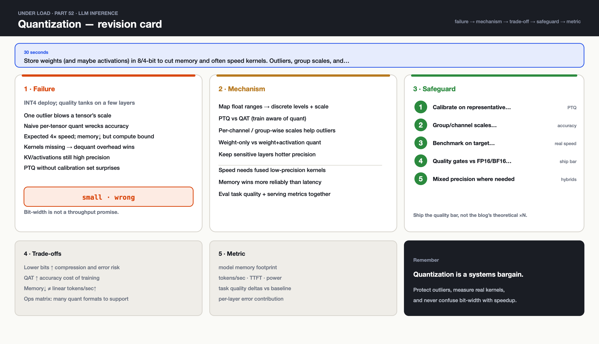
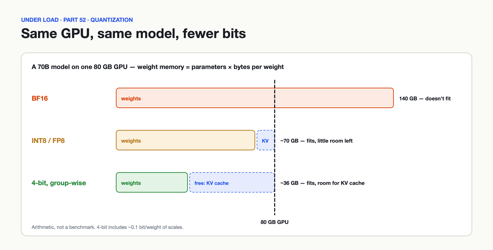
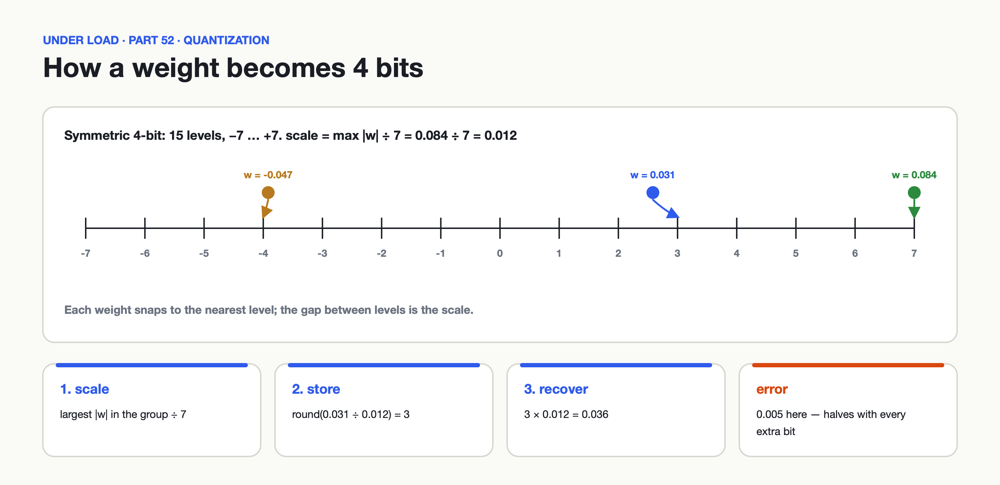
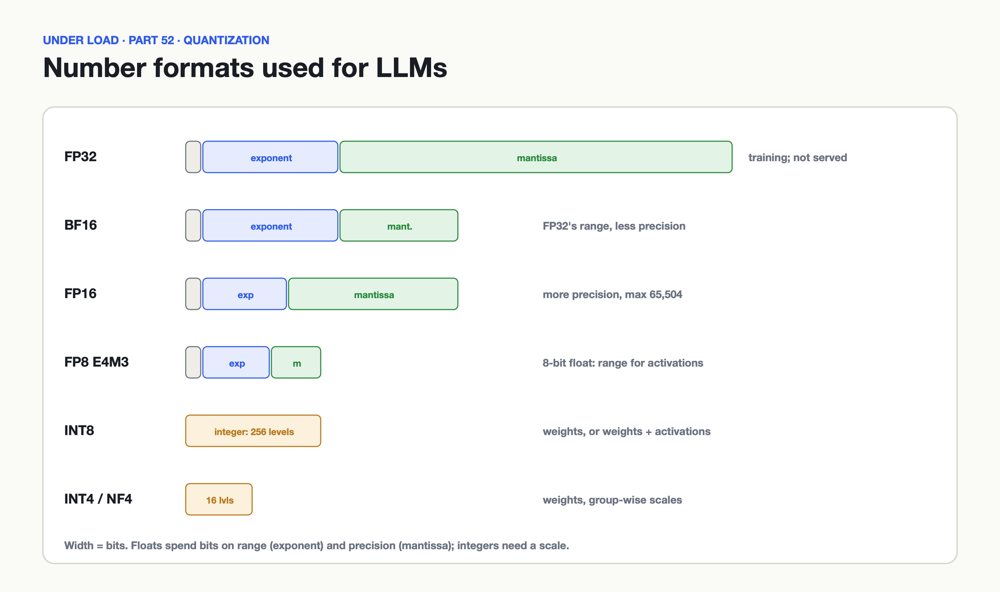
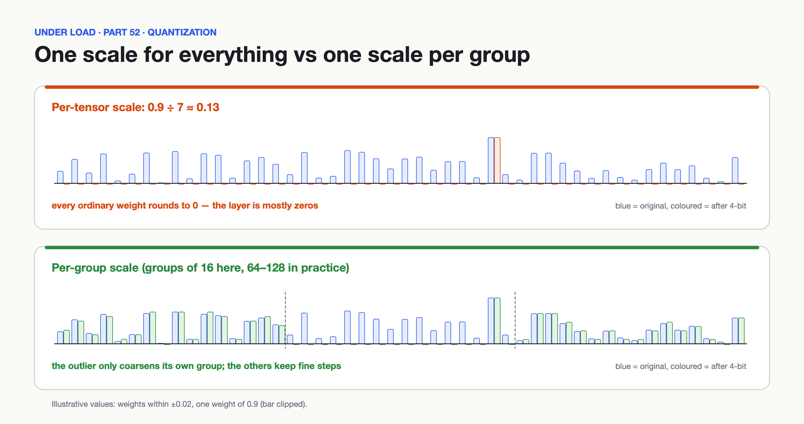
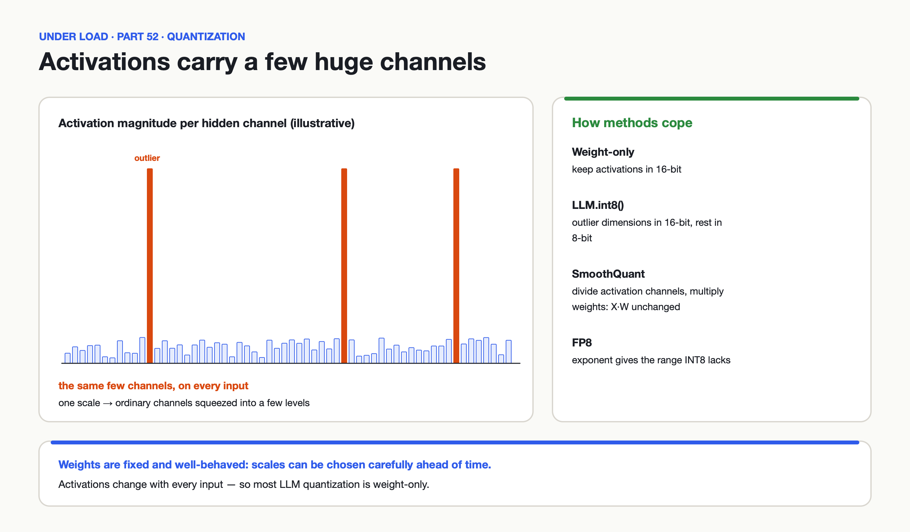
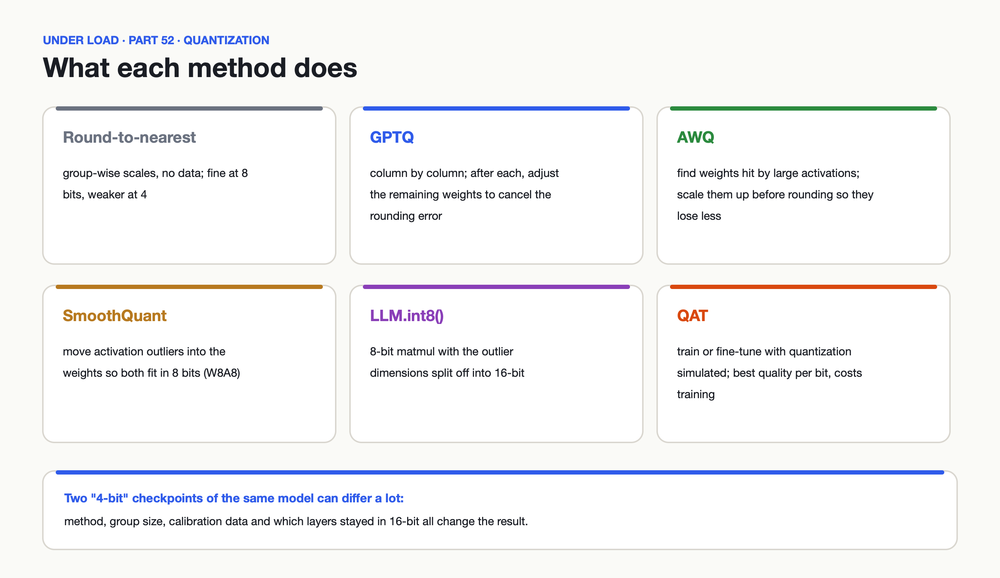
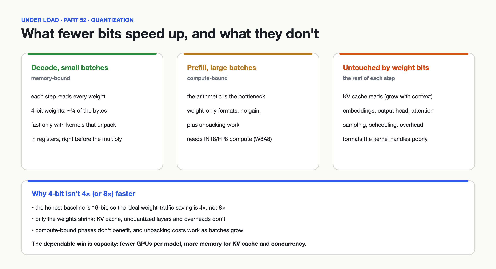
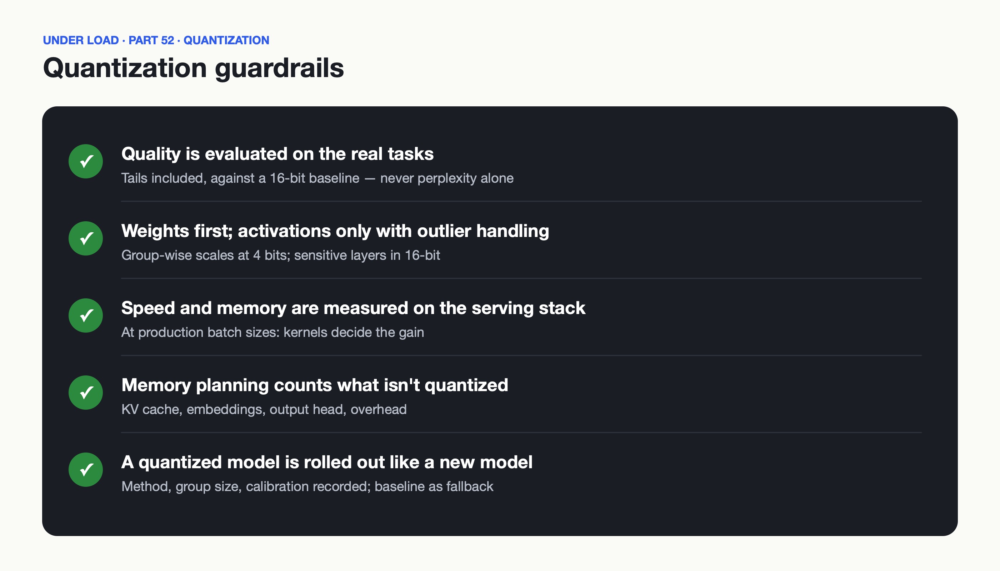

# Quantization

### Quantization: storing a model's numbers in 8 or 4 bits instead of 16 — how it works, why one large value can wreck a whole tensor, why activations are harder than weights, and why fewer bits don't mean proportionally faster.

*Under Load · Part 52 · LLM Inference Infrastructure*

---

The drafting assistant from Part 51 runs on a mid-sized model. The evaluation team has found that a 70-billion-parameter model writes noticeably better replies, and the question for the platform team is whether it can run on the hardware already in the rack: GPUs with 80 GB of memory each.

The arithmetic is unkind. Seventy billion parameters at 16 bits — 2 bytes each — is **140 GB** of weights. That doesn't fit on one GPU at all, and splitting it across two leaves little room for the KV cache, which Part 48 showed is what decides how many users can be served at once.

The standard answer is **quantization**: store the weights with fewer bits. At 8 bits the weights take about 70 GB; at 4 bits, about 35–40 GB, which fits on a single GPU with room left for tens of gigabytes of KV cache.

The first attempt used the most generic switch available in the team's framework — "quantize all linear layers to int8," weights and activations both, with default settings. The model got smaller and its answers got worse: invoice numbers transposed, refund amounts wrong, the occasional sentence that drifted into nonsense. A second attempt with a dedicated 4-bit weight-only method produced a model that was smaller still, and whose answers the evaluation set could barely tell apart from the original.

Both were "quantized." The difference was **what** was quantized and **how** its scales were chosen. This article explains both, and why the speed gain is never as simple as the bit count suggests.

---

## What quantization does

A model is mostly large matrices of **weights** — numbers learned during training — stored today as 16-bit floating point. Running the model multiplies **activations** (the intermediate values flowing through the network for the current input) by those weights, layer after layer.

**Quantization** represents those numbers with a small set of discrete levels instead of a floating-point format. The simplest scheme, **symmetric integer quantization**, works like this for a group of numbers:

1. Find the largest absolute value in the group, say 0.084.
2. Pick a **scale** so that value maps to the highest level. For 4-bit symmetric quantization the levels are −7 to +7, so scale = 0.084 / 7 = 0.012.
3. Store each number as the nearest level: `q = round(w / scale)`. A weight of 0.031 becomes round(2.58) = 3.
4. At compute time, recover an approximation: `w ≈ q × scale`. The 0.031 comes back as 0.036.

The difference between the original and the recovered value is **quantization error**. With more bits there are more levels, the steps between them are smaller, and the error is smaller. Each bit removed halves the number of levels and doubles the step.

**Asymmetric** quantization adds a **zero point** — an offset — so the levels can cover a range like −0.02 to +0.09 instead of a range centered on zero. It wastes fewer levels on lopsided distributions, at the cost of storing the offset.

### The formats in use

Not every low-precision format is an integer format. The ones that matter for LLM serving:

- **FP32** (32-bit float): what models are trained in, historically. Nobody serves large models in it.
- **FP16 and BF16** (16-bit floats): the standard serving precision. FP16 has more precision but a small range (its largest value is 65,504); **BF16** ("brain float") keeps FP32's range with less precision, which makes it robust for models with large values. Going from 32 to 16 bits is essentially lossless for inference.
- **INT8**: 256 levels. Used for weights alone, or for weights and activations together.
- **FP8** (8-bit floats, in two variants: E4M3 with more precision, E5M2 with more range): supported natively by recent data-center GPUs. Because it's a floating-point format, it handles a wide range of values better than INT8, which makes it the easiest 8-bit option for activations.
- **INT4 and 4-bit floats**: 16 levels. **NF4** ("normal float 4," from the QLoRA work) places its 16 levels where normally distributed weights are densest. The newest GPUs add native 4-bit floating-point formats as well.
- Below 4 bits — 3-bit, 2-bit — research methods exist, but quality loss grows quickly, especially for smaller models.

### Two ways to get a quantized model

- **Post-training quantization (PTQ)** converts an already-trained model. The simplest versions just round each weight; better ones use a small **calibration** dataset — a few hundred representative inputs — to measure how the model actually behaves and choose scales that minimize the damage. GPTQ, AWQ and SmoothQuant, described below, are PTQ methods. It takes minutes to hours and needs no training.
- **Quantization-aware training (QAT)** simulates quantization during training or fine-tuning: the forward pass uses quantized values, so the model learns weights that tolerate the rounding. It reaches better quality at very low bit-widths, but it costs a training run and access to suitable training data. Some model providers now publish QAT-trained low-bit versions of their models alongside the full-precision ones.

For most teams serving open-weights models, PTQ — usually a pre-quantized checkpoint produced with a well-known method — is the practical choice.

---

## Where the memory saving comes from — and where it doesn't

For the weights, the saving follows the bit-width closely. A 70B model:

- **BF16**: 70 billion × 2 bytes = **140 GB**.
- **INT8 / FP8**: 70 billion × 1 byte = **70 GB**, plus a little for scales.
- **4-bit**: 70 billion × 0.5 bytes = **35 GB**, plus scales. With one 16-bit scale per group of 128 weights, the overhead is 16 / 128 = 0.125 extra bits per weight — about 4.1 bits per weight in total, a little more with zero points.

The rest of the GPU's memory doesn't shrink automatically:

- **The KV cache** is a separate tensor, stored in 16-bit unless it's quantized too. Serving engines can store it in FP8, halving it, which directly doubles how many tokens of context fit (Part 48). It has its own quality trade-off.
- **Layers left in higher precision**: the **embedding table** (one vector per vocabulary token, which for a large vocabulary is a sizeable tensor), the final **output head** that turns hidden states into token probabilities, and normalization layers are often kept at 16 bits on purpose.
- **Activations, temporary buffers and runtime overhead** don't change with the weight format.

So "4 bits is a quarter of the memory" is true of the quantized weights, not of the deployment. Memory plans should add up what's actually stored at each precision.

---

## Scale granularity: one large value can wreck a tensor

The most important design decision in a quantization scheme isn't the bit-width; it's **how many numbers share one scale**.

- **Per-tensor**: one scale for an entire weight matrix — millions of numbers.
- **Per-channel**: one scale per row (output channel) of the matrix.
- **Per-group**: one scale for each consecutive block of, typically, 64 or 128 weights.

Consider a weight matrix where nearly every value lies within ±0.02, and one value is 0.9 — not unusual; trained networks have a few large weights. With 4 bits and a single per-tensor scale, that one value sets scale = 0.9 / 7 ≈ 0.13. Every ordinary weight, being smaller than half a step (0.064), rounds to **zero**. The matrix that comes back is almost entirely zeros plus a few large values, and the layer no longer computes anything resembling what it was trained to.

With a scale per group of 128, the 0.9 only affects its own group. Every other group gets a scale set by its own largest value — around 0.02 / 7 ≈ 0.003 — and keeps fine resolution. That's why every practical 4-bit scheme is group-wise: the scales cost a fraction of a bit per weight and buy most of the quality.

At 8 bits, there are 127 positive levels instead of 7, so even per-tensor or per-channel scales usually lose little for weights. Granularity matters more and more as the bit-width drops.

---

## Activations have outliers; weights mostly don't

The team's first attempt quantized **activations** as well as weights, and that's where most of the damage came from.

Weights are fixed after training, fairly well-behaved, and can be examined ahead of time to choose scales carefully. Activations are different in two ways:

- **They change with every input**, so their scales must either be computed on the fly ("dynamic" quantization) or estimated from calibration data and hoped to hold ("static").
- **They contain systematic outliers.** The LLM.int8() paper (Dettmers et al., 2022) showed that transformer language models develop a small number of hidden dimensions — **feature channels** — whose activation values are far larger than the rest, consistently across inputs and layers, and that these emerge clearly in models above a few billion parameters. Those channels matter: removing them destroys the model's quality.

When an activation tensor is quantized with one scale, the outlier channels set the scale, and every ordinary channel is squeezed into a handful of levels. It's the per-tensor weight problem again, except it happens on every input and can't be fixed by inspecting the weights.

That's why most LLM quantization in practice is **weight-only** — weights in 4 or 8 bits, activations in 16 — and why methods that quantize activations deal with outliers explicitly:

- **LLM.int8()** splits each matrix multiplication: the few outlier feature dimensions are computed in 16-bit, and everything else in 8-bit with fine-grained scales. Quality is preserved even at very large model sizes, at the cost of extra work to split and recombine.
- **SmoothQuant** (Xiao et al., 2023) uses the fact that a matrix multiplication X·W is unchanged if one column of X is divided by a factor and the matching row of W is multiplied by it. It picks per-channel factors that shrink the activation outliers and move that magnitude into the weights, which are easier to quantize. Both can then be stored in 8 bits ("W8A8"), and the multiplication can use the GPU's fast 8-bit units.
- **FP8 activations** avoid part of the problem by using a floating-point format, whose exponent gives it far more range than INT8 for the same 8 bits. On GPUs that support it, FP8 weights and activations with per-tensor or per-channel scales are often the least troublesome way to get 8-bit compute.

---

## The methods behind pre-quantized checkpoints

Most teams don't write quantization code; they download a checkpoint labeled GPTQ, AWQ, FP8 or similar, or run a library that produces one. The labels describe how the scales and rounded values were chosen:

- **Round-to-nearest (RTN)**: round every weight to its nearest level with group-wise scales. Fast, no data needed, and surprisingly decent at 8 bits; noticeably worse than the methods below at 4 bits.
- **GPTQ** (Frantar et al., 2023): quantizes a layer's weights one column at a time, and after each column **adjusts the not-yet-quantized weights to compensate** for the rounding error just introduced, using second-order information estimated from calibration data. The layer's output stays close to the original even though each weight was rounded. Works well at 4 bits and reasonably at 3.
- **AWQ** (Lin et al., 2024): observes that a small fraction of weights — the ones multiplied by large activations — matter far more than the rest. Instead of keeping them in higher precision (which would complicate kernels), it **scales those channels up before quantizing** so they lose less precision, folding the inverse scale into the preceding operation. It needs only a small calibration set and no weight reconstruction, which makes it less prone to overfitting the calibration data.
- **SmoothQuant** and **LLM.int8()**: for quantizing activations as well, as above.
- **QAT checkpoints**: trained to tolerate quantization, usually the best quality at a given bit-width.

Two consequences follow. First, two "4-bit" versions of the same model can behave very differently — the method, group size, calibration data and which layers were left in higher precision all matter. Second, **calibration data shapes the result**: a model calibrated on generic web text may hold up less well on support tickets full of order numbers, product codes and non-English names than one calibrated on representative traffic.

---

## Fewer bits isn't proportionally faster

Quantization's memory saving is predictable. Its speed gain is not, because it depends on what limits each phase of inference.

**Decode at small batch sizes is memory-bound** (Parts 48 and 50): each step reads every weight to produce one token per sequence. Here weight-only quantization helps directly. Reading 4-bit weights instead of 16-bit ones moves a quarter of the bytes, and well-optimized kernels — ones that load the packed 4-bit values and unpack them in the GPU's registers, right before the multiplication — can approach that ideal at small batch sizes. Without such kernels, the weights are expanded back to 16 bits in memory before use, and the saving is memory only.

**Prefill and large-batch decode are compute-bound.** The multiplication itself is the bottleneck, and weight-only quantization doesn't reduce it — the arithmetic still happens in 16 bits, plus the work of unpacking. Speedups here come from computing in low precision: INT8 or FP8 weights *and* activations, on hardware whose 8-bit units do more operations per second than its 16-bit ones.

So the answer to "why doesn't 4-bit give a 4× (or, against FP32, 8×) speedup?" has several parts:

- **Nobody serves in FP32**, so the honest baseline is 16-bit, and the ideal weight-traffic saving is 4×, not 8×.
- **Only the weights shrink.** Each decode step also reads the KV cache, which grows with context and isn't touched by weight quantization. For long conversations, it can be a large share of the step's memory traffic.
- **Unpacking costs work**: scales must be applied and 4-bit values expanded, and that eats part of the gain, more so as batches grow.
- **Compute-bound phases don't benefit** from weight-only formats at all.
- **Kernel quality varies** by format, GPU and engine. A format the hardware or engine supports poorly can be *slower* than 16-bit.
- **Non-quantized layers and overheads** — embeddings, output head, attention, sampling, scheduling — are unchanged.

In practice the biggest win is often **capacity** rather than per-token speed: a model that fits on one GPU instead of two (no cross-GPU communication), or the same model with far more memory left for KV cache, which means more concurrent sequences per GPU and lower cost per token.

---

## When to keep some layers at higher precision

Quantization error isn't spread evenly. A few parts of a model tend to be both sensitive and small enough that keeping them at 16 bits costs little:

- **The embedding table and the output head**, which map between tokens and hidden states. Errors here affect every token directly.
- **The first and last transformer blocks**, which some studies and tools find more sensitive than the middle ones.
- **Layers identified by measurement**: quantize one layer at a time, measure the quality drop on a calibration set, and keep the worst offenders in higher precision. Mixed-precision schemes are common in production checkpoints.
- **Smaller models in general.** Larger models usually tolerate low bit-widths better than small ones; a 4-bit 70B model often holds up far better than a 4-bit 1B model.

The cost is memory and sometimes kernel complexity, so the decision is a measured trade-off, not a default.

---

## Evaluating a quantized model

A quantized model is a **new model**. It should pass the same evaluation as any model change before it serves traffic.

- **Perplexity** — a measure of how surprised the model is by real text, where lower is better — is a fast first check. It catches broken quantization. It doesn't measure whether a support reply is correct.
- **Task evaluations** against the 16-bit baseline: extraction accuracy (order numbers, amounts, dates), classification, tool-call validity (Part 45), groundedness (Part 44), the drafting quality rubric.
- **The tails, not just the average.** Quantization often damages rare skills first: arithmetic and exact numbers, code, long-context retrieval, and non-English languages, which studies have found can degrade more than English under the same scheme. A support product with international customers needs those slices in its evaluation set.
- **Side-by-side comparison** of outputs on the same prompts, including refusals and formatting, since behaviour around safety and structured outputs can shift.
- **Performance on the serving hardware**: memory, tokens per second, time to first token and inter-token latency, at realistic batch sizes, against the 16-bit baseline.

---

## Shipping it safely

1. **Start from a well-known method and checkpoint** (GPTQ, AWQ, FP8) rather than a generic "quantize everything" switch, and record exactly what it is: method, bit-width, group size, which layers were kept in higher precision, calibration data, kernel and engine version.
2. **Calibrate on representative data** if producing the checkpoint in-house.
3. **Evaluate quality and performance together**, against the 16-bit baseline, including the tail slices.
4. **Re-plan memory** with what's actually stored at each precision, and decide where the freed memory goes — usually KV cache and concurrency.
5. **Roll out like a model change**: a canary or shadow deployment, with task-quality metrics compared to the baseline, and the 16-bit model kept ready as a fallback.
6. **Invalidate dependent caches.** A quantized model computes different values: prompt caches (Part 49) and anything else keyed on the model must treat it as a different model.

---

## Guardrails that prevent the next one

1. **Quality is evaluated on the real tasks**, including the tails, against a 16-bit baseline, for every format and version — perplexity alone is never the release gate.
2. **Weights first; activations only with outlier handling** (SmoothQuant, LLM.int8(), FP8), group-wise scales at 4 bits, and sensitive layers kept at higher precision.
3. **Speed and memory are measured on the serving hardware and engine**, at production batch sizes: kernels decide the gain, not the bit-width.
4. **Memory planning counts what isn't quantized**: KV cache, embeddings, output head, activations and runtime overhead.
5. **A quantized model is versioned and rolled out like a new model**, with its method, group size and calibration data recorded and the baseline kept as a fallback.

---

## What to keep on the dashboard

- **Task quality** on the evaluation set, per model version and format, including tail slices (numbers, languages, long context).
- **GPU memory** split into weights, KV cache and overhead.
- **Tokens per second**, **time to first token** and **inter-token latency**, against the 16-bit baseline at the same load.
- **Concurrent sequences per GPU**, the capacity the memory saving bought.
- **GPU utilization and power**, and **cost per million tokens**.
- **Error, refusal and invalid-output rates**, which can shift after a format change.

---

## Recap

### What is quantization?
Representing a model's weights — and sometimes its activations and KV cache — with fewer bits, by mapping values to a small set of levels with a scale (and sometimes a zero point) per tensor, channel or group, and approximately recovering them at compute time.

### Why can quantization improve inference speed?
Decoding at small batch sizes is memory-bound: every step reads all the weights. Fewer bytes per weight means less data to move, so with kernels that work directly on the low-bit format, each step can be faster. Computing in INT8 or FP8 also helps compute-bound phases on hardware that supports it.

### What is the difference between post-training quantization and quantization-aware training?
PTQ converts an already-trained model, often using calibration data to choose scales or compensate rounding error (GPTQ, AWQ, SmoothQuant); it's fast and common. QAT simulates quantization during training or fine-tuning so the model learns to tolerate it — better at very low bit-widths, at the cost of training.

### Why doesn't 4-bit precision mean a proportional speedup?
The real baseline is 16-bit, not 32; only the weights shrink, while the KV cache and non-quantized layers don't; unpacking and scaling cost work; prefill and large-batch decode are compute-bound and gain nothing from weight-only formats; and the gain depends on kernel support on the specific hardware.

### Why are group-wise scales needed?
With one scale per tensor, a single large value sets the step size for millions of weights, and at 4 bits almost all ordinary weights round to zero. A scale per group of 64–128 weights confines each outlier to its group, for a fraction of a bit per weight.

### Why are activations harder to quantize than weights?
Activations change with every input and contain a few persistent outlier channels much larger than the rest, so one scale squeezes everything else into a handful of levels. LLM.int8() computes the outlier dimensions in 16-bit, SmoothQuant moves their magnitude into the weights, and FP8's range tolerates them better than INT8.

### When would you keep some layers at higher precision?
When they're sensitive and small: embeddings, the output head, often the first and last blocks, or any layer that measurement shows causes most of the quality loss — and more readily for smaller models, which tolerate low bit-widths worse.

### Does quantization save memory exactly in proportion to bit-width?
Only for the quantized weights, plus a little for scales. The KV cache, layers kept in 16-bit, activations and runtime overhead stay as they are unless handled separately.

### How do you evaluate a quantized model?
As a new model: task evaluations against the 16-bit baseline, with attention to rare skills such as numbers, code, long context and non-English text, plus memory and speed measured on the serving hardware at realistic load.

---

## Next

- **Lab (run + measured write-up):** [52-quantization](https://github.com/b-basoglu/under-load/tree/main/52-quantization)
- **Next:** [Model Routing](../53-model-routing/article.md) — Most support questions don't need the biggest model. How to send each request to the cheapest model that can answer it — and catch the ones it can't.
