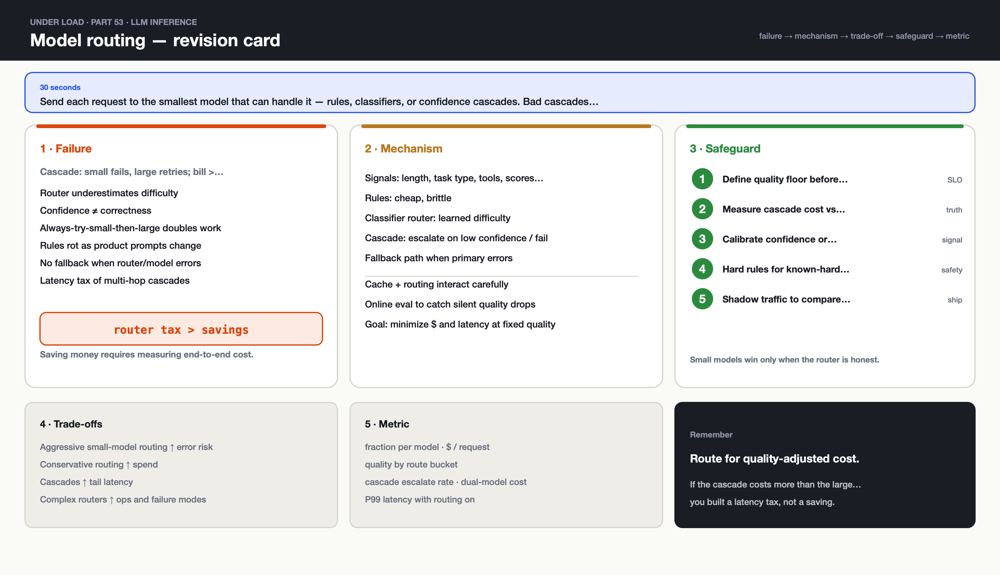
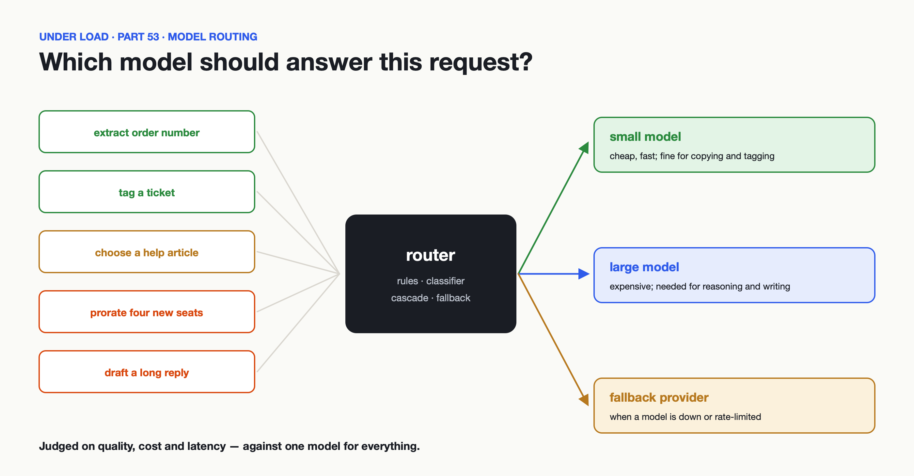
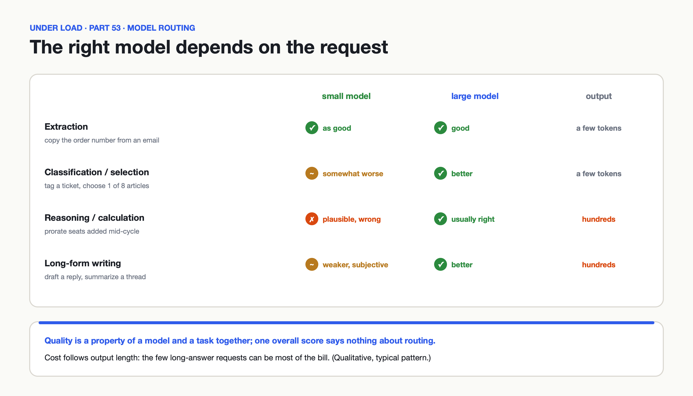
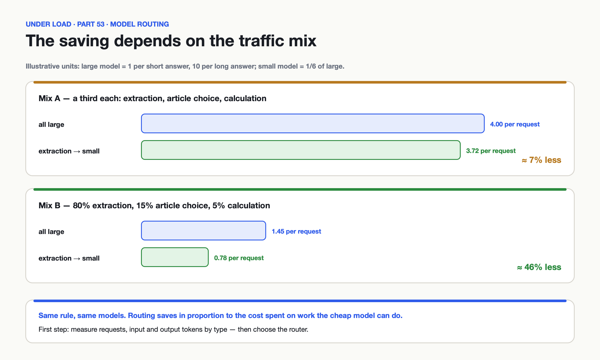
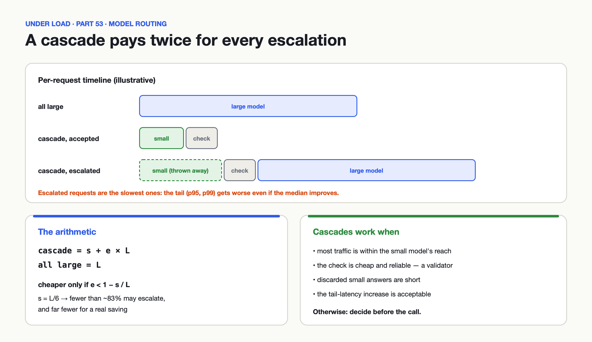
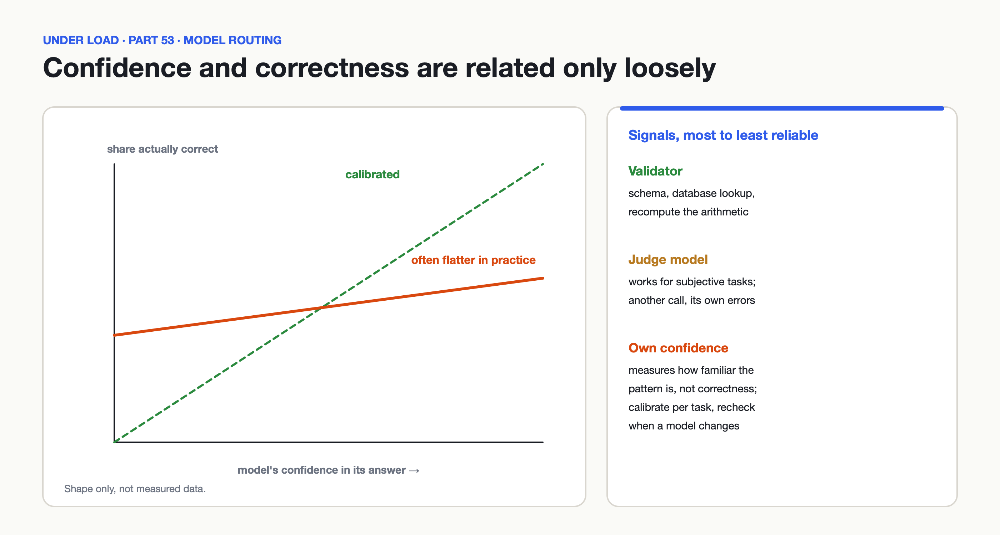
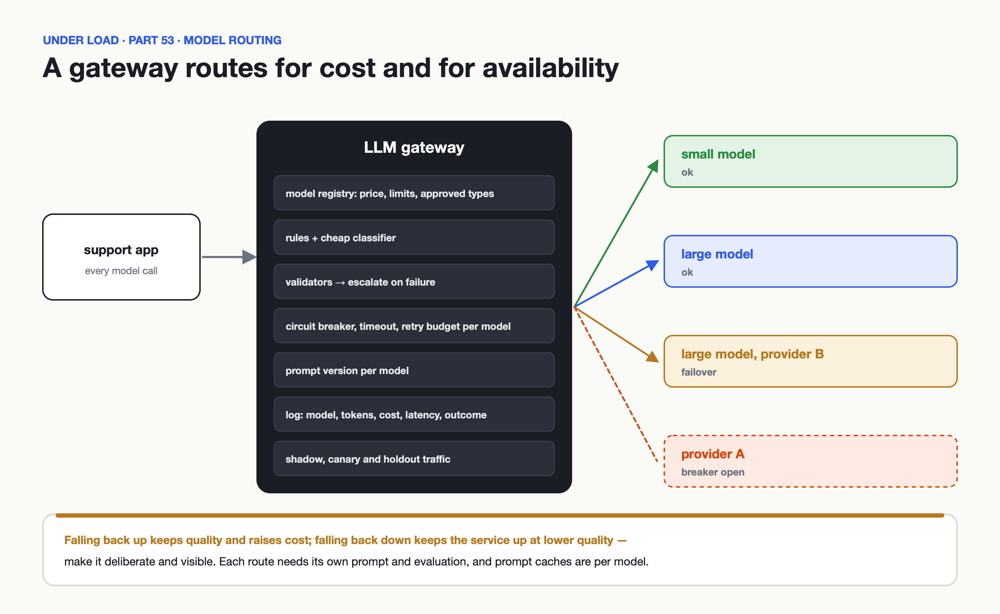
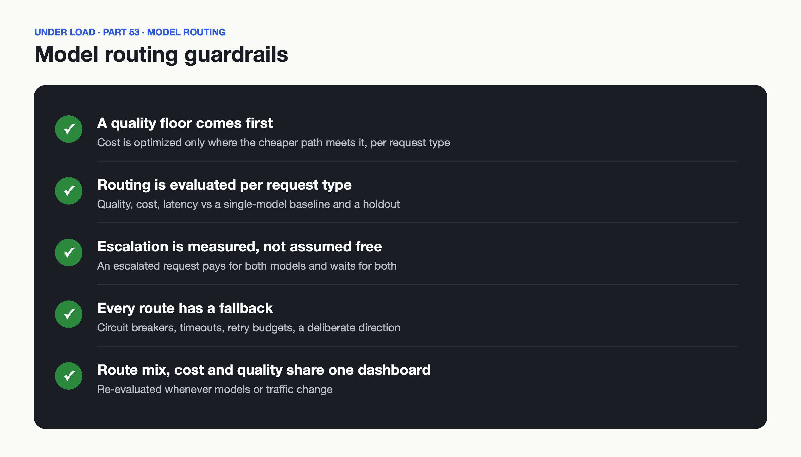

# Model Routing

### Model routing: sending each request to the smallest model that handles it well — rules, classifiers and confidence cascades, fallbacks when a model is down — and why the obvious "try small first" design can cost more than using the big model for everything.

*Under Load · Part 53 · LLM Inference Infrastructure*

---

The support assistant sends every request to the largest model the company has access to. The bill grows in lockstep with traffic, and a look at the logs shows why that feels wasteful: most requests are simple. Copy the order number out of a customer's email. Tag a ticket as billing, technical or account. Pick which help article answers "our SSO login loops back to the sign-in page." A model a fraction of the size could do much of that, faster and for a fraction of the price.

The idea is **model routing**: put a decision in front of the models, and send each request to the cheapest one that can answer it well.

The first design the team sketched was the intuitive one: *try the small model first, and if it seems unsure, ask the big one.* On paper, every easy request becomes cheap and every hard one still gets the big model. In a pilot on real traffic, it cost **more** than sending everything to the big model, made the slowest requests slower, and didn't improve a single answer. The second design — a plain rule that sent one known-easy request type to the small model — saved less on paper and turned out to be the one that worked.

This final part of the series explains why, and how to build a router that saves money without quietly lowering quality.

---

## What a router decides

A **router** is the component that chooses, for each incoming request, which model handles it — or which provider, region, model version or configuration. It can make that choice at three moments:

- **Before** any model runs, from what's known about the request: which endpoint it came from, its type, its length, the customer's plan, whether it needs tools or images, or a prediction from a small **classifier** trained to estimate difficulty.
- **After** a cheaper model has answered, from that answer: whether it passed a check, or how confident the model seemed. If it's not good enough, the request **escalates** to a stronger model. This design is a **cascade**.
- **When something fails**: a model is down, slow, rate-limited or refuses. The router sends the request elsewhere. This is **fallback**, and it's routing for availability rather than for cost.

Model routing happens **between** models. It's different from a **mixture-of-experts** model, which routes each token to a subset of its own internal sub-networks; that's an architecture detail inside one model, invisible to the application.

Every routing policy is judged on the same three numbers — **quality** (how often the answer is right or acceptable), **cost** and **latency** — compared against the simplest possible baseline: one model for everything. A router that can't beat that baseline on cost or latency without losing quality is overhead.

---

## The right model depends on the task, not the model

A common shortcut is to rate models on one overall score: "the small model is 70% as good as the large one." That number is almost useless for routing. Quality is a property of **a model and a task together**.

The support assistant's traffic contains very different work:

- **Extraction** — find the order number, the invoice ID, the email address in a message. The answer is in the input; the job is to copy it correctly. Small models are often as reliable as large ones here.
- **Classification and selection** — tag a ticket, choose one of eight help articles. The answer is short, but choosing it needs some understanding of the product. Small models are usually somewhat worse, and how much worse depends on how subtle the categories are.
- **Reasoning and calculation** — "A seat costs $18 a month; the customer adds four seats with twenty days left in the billing cycle; how much do we charge today?" Small models often produce plausible-looking working and a wrong number.
- **Long-form writing** — draft a reply, summarize a long thread. Quality differences are real but subjective, and harder to measure.

A router built on this view has a simple first job: for each request type, find the cheapest model that meets the quality bar on an evaluation set of that type. Some types will go to the small model with no loss at all. Others won't.

### Cost follows output length, not request count

The second thing the logs reveal is where the money actually goes. LLM cost — tokens on a hosted API, GPU time on a self-hosted one — is driven largely by **output tokens**, since each one is a sequential decode step (Part 48), and output tokens are typically priced several times higher than input tokens.

An extraction or a classification produces a handful of tokens. A calculation with its working, or a drafted reply, produces hundreds. So a request type that's a small share of traffic can be most of the bill. **Reasoning models** make this sharper: the thinking they do before answering is billed as output tokens, even though the user never sees it. The same short answer can cost a few hundred tokens or several thousand depending on how much the model reasoned. That changes what routing can save: moving the many cheap requests to a small model may save surprisingly little, while the few expensive ones decide the total.

---

## Rules: decide before the call

The simplest router uses something already known about the request. In the support product, every request arrives through an endpoint that says what it is — `extract-order-ref`, `suggest-article`, `draft-reply` — so the route can be a lookup table.

How much a rule saves depends entirely on the traffic mix. A worked example, in illustrative cost units where a large-model call for a short answer costs 1, a long answer costs 10, and the small model costs a sixth of the large one:

- **Mix A — a third each** of extraction (short), article choice (short) and calculation (long). Sending everything to the large model costs (1 + 1 + 10) / 3 = **4.0** units per request. Routing extraction to the small model costs (0.17 + 1 + 10) / 3 ≈ **3.7** — about **7% less**, because the expensive third didn't move.
- **Mix B — 80% extraction**, 15% article choice, 5% calculation. All-large costs 0.8 + 0.15 + 0.5 = **1.45** units. The same rule costs 0.13 + 0.15 + 0.5 ≈ **0.78** — about **46% less**.

Same rule, same models, very different savings. That's why the first step in building a router isn't choosing a routing technique; it's **measuring the traffic**: requests, input tokens and output tokens by type, and the cost of each.

Rules are cheap (no extra model call), predictable, and easy to evaluate: each route can be tested on that type's evaluation set. Their limit is that they only know what the request's metadata says. Two requests from the same endpoint can differ wildly in difficulty — "where's my invoice?" and "why was I charged twice after the plan change, and what will next month look like?" both arrive at `answer-billing-question`.

### Signals beyond the endpoint

When the endpoint doesn't determine difficulty, a router can use other signals available before the call:

- **Required capabilities**: does the request need tool calling (Part 47), image input, structured output, a particular language? Some models don't support some features, and that's a hard constraint, not a preference.
- **Context length**: a 100,000-token thread can only go to a model with a large enough context window.
- **Latency target**: an interactive autocomplete with a tight budget may need the fastest model regardless of quality differences; an overnight summary can wait for the best one.
- **Tenant and plan**: an enterprise contract may promise the top model; a free tier may be capped to a cheaper one.
- **A learned classifier**: a small, fast model — or even a simple model on embeddings — trained to predict whether the cheap model will succeed on this request. Research systems such as RouteLLM (Ong et al., 2024) train routers like this on preference data, comparing which model's answers people preferred, and report substantial cost reductions at similar quality on their benchmarks. The classifier must be cheap relative to what it saves; a router that calls a large model to decide where to send the request has spent the saving before any answer exists.

Many production routers are **hybrids**: hard rules for capabilities, contracts and context length first, then a cheap classifier or per-type default for everything else.

The choice isn't only *which model*. Current models expose a **reasoning effort** setting — `reasoning.effort` in OpenAI's API, `output_config.effort` in Anthropic's — that trades thinking tokens for quality on the same model. Routing an easy request to low effort can save as much as routing it to a smaller model, without changing model contracts. Routing is also increasingly offered as a service: Amazon Bedrock's intelligent prompt routing picks between two models of one family per request, gateways such as OpenRouter offer an automatic router, and some providers route between model variants behind a single model name. A managed router still has to be evaluated on the product's own traffic, like any other.

---

## Cascades: try small, escalate when unsure

A **cascade** decides after the fact. The small model answers; a check decides whether to accept that answer or send the request up to a stronger model. Research on cascades — FrugalGPT (Chen, Zaharia and Zou, 2023) is a well-known example — reports large savings on some benchmarks, and the design is attractive because it doesn't need to know in advance which requests are hard.

The catch is in the arithmetic. With small-model cost **s**, large-model cost **L**, and escalation rate **e** (the share of requests that go up):

- **Cascade cost per request = s + e × L**, because every request pays for the small model, and escalated ones pay for both.
- **All-large cost = L.**

The cascade is cheaper only if s + e·L < L, that is, **e < 1 − s/L**. If the small model costs a sixth of the large one, the cascade saves money only while fewer than about 83% of requests escalate — and saves meaningfully only if far fewer do. On Mix A above, where two-thirds of traffic is beyond the small model, the cascade pays for the small model on everything and the large model on two-thirds — before counting that the small model's wasted answers on the long, hard requests are themselves long. The result is a bill *higher* than sending everything to the large model, which is exactly what the pilot found.

Latency follows the same pattern. An escalated request waits for the small model's full answer, then the check, then the large model's answer. The slowest requests are exactly the ones that escalate, so **tail latency** — the p95 or p99 time — gets worse even if the median improves. Streaming makes it more awkward still: the small model's answer can't be shown to the user until it has been checked, which removes much of streaming's benefit.

### What makes a good check

Everything depends on the check that decides whether to escalate. From most to least reliable:

- **A validator** that checks the output objectively: the JSON parses and matches the schema (Part 45), the order number exists in the database, the cited help article is real, the arithmetic in the answer recomputes. When a task allows one, it's the best signal, because it measures correctness directly.
- **A judge model** that grades the answer. It works for subjective tasks, but it's another model call on every request, and the judge has its own error rate.
- **The model's own confidence**, typically from the probabilities it assigned to its answer tokens. It's free, and it's the weakest signal.

Confidence is weak because a model's token probabilities measure how familiar the output *pattern* is, not whether the content is right. A confidently formatted wrong number looks exactly as fluent as a right one. The term for whether confidence matches reality is **calibration**: a calibrated model that says "80% sure" is right about 80% of the time. Language models are often poorly calibrated, and post-training to follow instructions can make it worse — the GPT-4 technical report, for example, showed the pre-trained model's confidence was well calibrated and the post-trained model's much less so. How confidence is computed also matters: the probability of the first few tokens of an answer often reflects a fixed prefix ("ORD-") rather than the part that can be wrong.

So a confidence threshold has to be **calibrated per task on real traffic**, by checking how often answers in each confidence band are actually right, and rechecked whenever either model changes. A threshold that's too low passes wrong answers; one that's too high escalates almost everything and turns the cascade into "large model plus waste."

### When cascades work

Cascades are the right design when:

- **Most traffic is within the small model's reach**, so the escalation rate is low.
- **The check is cheap and reliable** — ideally a validator.
- **The small model's wasted work on escalated requests is short** — a short answer that fails validation costs little to throw away.
- **Latency isn't critical**, or the tail increase is acceptable.

Where those don't hold, a rule or classifier **before** the call beats a check **after** it.

---

## Handling low-confidence routing decisions

Whatever the design, some requests will be ambiguous: the classifier is unsure, the confidence is borderline, the request doesn't fit a known type. The safe defaults:

- **Default to the stronger model** when unsure. The cost of over-escalating a few ambiguous requests is usually smaller than the cost of a wrong answer to a customer.
- **Validate where possible** instead of guessing: a cheap check on the cheap model's output resolves many borderline cases objectively.
- **Ask, don't guess**, when the ambiguity is in the request itself — a short clarifying question can be cheaper than an expensive answer to the wrong question.
- **Hand off to a human** for the support cases that matter most: a refund dispute, an angry enterprise customer, anything with legal or financial weight.
- **Log the uncertain decisions** with their outcomes. They're the best training data for improving the router.

---

## Fallback: routing for availability

Routing infrastructure earns its place even where it saves no money at all: models go down, providers have incidents, rate limits are hit, regions degrade.

- **Per-model circuit breakers** (Part 16): when a model's error rate or latency crosses a threshold, stop sending it traffic for a while instead of letting every request wait for a timeout.
- **Timeouts and retries with budgets** (Part 15): a retry to a different model or provider, not the same failing one, and within a retry budget so failover doesn't become a retry storm.
- **Failover direction matters.** Falling back **up** — to a stronger model when the cheap one is down — keeps quality and raises cost; capacity and rate limits on the stronger model must allow for it. Falling back **down** — to a weaker model when the strong one is down — keeps the service up at lower quality. That's graceful degradation (Part 20), and it should be deliberate and visible: flagged in the response, shown on the dashboard, perhaps limited to request types where the weaker model is known to be acceptable.
- **Same model, multiple providers or regions** is often the cleanest fallback: the same open-weights or hosted model served by two providers, so failover doesn't change behaviour.

### Different models are different contracts

A route to another model isn't a drop-in swap. Models differ in their prompt formats and system-prompt behaviour, how they call tools, how strictly they follow schemas, their safety and refusal behaviour, their context limits and tokenizers, and their output style. A prompt tuned for one model may perform poorly on another. Each route needs its own prompt version and its own evaluation, and a fallback route that's never exercised will fail the day it's needed — which is a good reason to send it a small slice of traffic continuously.

Routing also interacts with caching. Prompt caches are per model (Part 49), so splitting one stream of traffic across several models splits its cache reuse too; a route that sends 10% of requests to a second model gives that model a cold, low-hit-rate cache.

---

## When routing increases cost or latency

Routing is meant to cut cost and latency, and there are several ways it does the opposite:

- **Cascades with high escalation rates** pay for two models on most requests and wait for both.
- **Expensive routing decisions**: a large model used as the router, or a judge on every request.
- **An extra network hop** through a gateway, on latency-critical paths.
- **Cache fragmentation**: prompt caches split across models, so each model's hit rate falls.
- **Over-escalation**: a classifier tuned to be "safe" that sends almost everything up.
- **Retry and failover storms**: a fallback that retries every failed call on a second model doubles load exactly when things are already degraded.
- **Quality regressions that cost money later**: a wrong answer from the cheap model that reopens a ticket, triggers a human escalation or loses a customer costs more than the tokens saved.

---

## Evaluating a router

The hardest part of routing isn't the routing; it's knowing whether it worked.

- **Define a quality floor first.** For each request type, the minimum acceptable accuracy or rating on an evaluation set. Cost is optimized only within that constraint.
- **Evaluate per route and per type**, against the single-model baseline, on the same requests.
- **When quality is subjective**, use pairwise comparisons — is the routed answer at least as good as the large model's? — rated by people for a sample, and by a judge model calibrated against those human ratings for the rest.
- **Use downstream outcomes**, which are slower but real: ticket reopen rate, escalations to human agents, customer satisfaction, resolution time. Quality labels are often delayed and expensive; these are the ones that matter.
- **Keep a holdout**: a small share of traffic always sent to the baseline model, so quality and cost can be compared continuously rather than once at launch.
- **Shadow before switching**: send a copy of traffic to a new route, compare answers offline, then canary a small real share.
- **Re-evaluate on change.** Models are updated, new cheaper models appear, traffic shifts. A routing table that was right in spring can be wrong by autumn.

---

## Guardrails that prevent the next one

1. **A quality floor comes first.** Routing for cost applies only where the cheaper path still meets it, per request type, on an evaluation set.
2. **Routing is evaluated per request type** — quality, cost and latency — against a single-model baseline and a continuous holdout.
3. **Escalation is measured, not assumed free.** An escalated request pays for both models and waits for both; cascades ship only where the escalation rate and the check justify them.
4. **Every route has a fallback**, with per-model circuit breakers, timeouts, retry budgets and a deliberate failover direction.
5. **Route mix, cost and quality are on one dashboard**, and the routing table is re-evaluated whenever models or traffic change.

---

## What to keep on the dashboard

- **Route distribution**: share of requests and of output tokens per model, by request type.
- **Quality per route**: task accuracy on sampled evaluations, validator pass rate, judge scores, user feedback, ticket reopen and human-handoff rates.
- **Escalation rate** and the **cost of discarded cheap-model work**.
- **Fallback rate**, circuit-breaker state and error rate per model and provider.
- **Cost per request** and **per resolved ticket**, against the single-model baseline.
- **Time to first token and end-to-end latency** per route, at p50 and p95, including cascades.
- **Quality versus cost** relative to the baseline, over time, so drift is visible.

---

## Recap

### What is model routing?
Choosing, for each request, which model handles it — to send work to the cheapest model that answers it well, to respect capabilities and contracts, and to route around models that are down. It usually lives in an LLM gateway in front of the models.

### What signals would you use to route between a small and a large model?
Request type or endpoint, required capabilities (tools, images, structured output), context length, latency target, tenant or plan, and optionally a cheap learned classifier predicting whether the small model will succeed. After a call: a validator's verdict, a judge's score, or — weakest — the model's own confidence.

### Rules, classifiers or cascades?
Rules and classifiers decide before the call; they're cheap and predictable, and they're limited by what's known about the request. Cascades decide after a cheap model answers; they need no advance knowledge of difficulty but pay twice and wait twice for every escalation. Hybrids are common: hard rules first, then a classifier or per-type default.

### Why can a cascade cost more than using the large model for everything?
Its cost per request is s + e·L, against L for all-large. When the escalation rate e is high, or the small model's discarded answers are long, the duplicated work outweighs the savings on the requests the small model keeps — and tail latency rises because escalated requests wait for both models.

### Is model confidence a reliable routing signal?
Not on its own. Token probabilities reflect how familiar the output pattern is, not whether it's correct, and post-trained models are often poorly calibrated. Confidence thresholds must be calibrated per task on real traffic; validators that check the output are more reliable when the task allows one.

### How should low-confidence routing decisions be handled?
Default to the stronger model, validate where possible, ask a clarifying question when the request itself is ambiguous, hand high-stakes cases to a human, and log the decisions with their outcomes to improve the router.

### How do you evaluate a router when quality is subjective?
Set a quality floor per request type, compare routed answers with the baseline model's on the same requests — pairwise ratings by people on a sample, calibrated judge models on the rest — track downstream outcomes such as reopen and escalation rates, and keep a continuous holdout on the baseline.

### When can routing increase latency or cost instead of reducing it?
Cascades with high escalation, an expensive routing model or judge, an extra network hop, prompt-cache fragmentation across models, over-escalation, failover retry storms, and cheap wrong answers that cost more downstream than the tokens they saved.

### What determines the cost saving?
The share of total cost spent on work the cheap model can handle at the quality floor. Because cost follows output length, a small share of long-answer requests can dominate the bill: the same rule can save a few percent on one traffic mix and nearly half on another.

---

## Next

- **Lab (run + measured write-up):** [53-model-routing](https://github.com/b-basoglu/under-load/tree/main/53-model-routing)
- **End of the series.** Fifty-three parts, from indexes to model routing.
